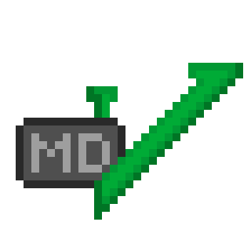

# mdv (Markdown Viewer)



Minimal no BS markdown viewer, written in [Golang](https://go.dev).
Inspired by [imv](https://git.sr.ht/~exec64/imv)

## Build
```sh
go build \
  -ldflags='-s -w' \
  -o mdv \
  .
```

## Usage
```text
mdv: No BS, minimal markdown viewer

Usage: mdv [FILE]
```

## What to use a markdown extension that is not enabled?
Check out [./extend.go](./extend.go) to add extensions supported by [gomarkdown/markdown](github.com/gomarkdown/markdown)

It also lets you directly manuplate the AST but at that point you are better of forking the repo

## I want to contribute
Sure go ahead, but follow these rules

- use commit prefixes
- have a fun commit body (optional)
- AI assisted is allowed, slop written isent
